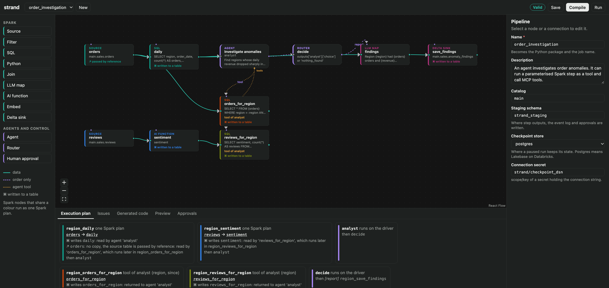
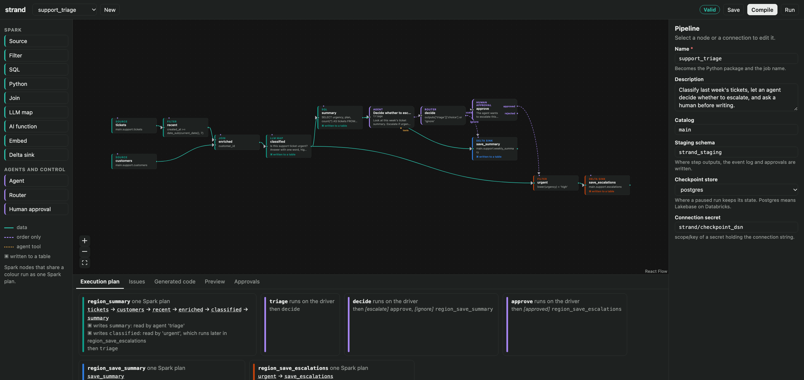

# strand

Visual pipelines that mix Spark transformations and AI agents, compiled to readable
PySpark + LangGraph and packaged as a Databricks Asset Bundle.



*`order_investigation`: the agent can run two parameterised Spark steps as tools (dotted lines) and call MCP tools.*



*`support_triage`: six Spark nodes fused into one plan, then an agent, a router and a human approval before the write.*

## Run the editor

```bash
uv venv --python 3.12 && uv pip install -e ".[run,dev]"
cd web && npm install && npm run build && cd ..
.venv/bin/strand serve          # http://127.0.0.1:8000
```

Pipelines are saved as YAML in `pipelines/`. `http://127.0.0.1:8000/?pipeline=<name>` opens one directly. **Compile** writes the generated project to `build/<name>/`.

## Command line

```bash
strand check examples/support_triage.yaml     # validate and print the execution plan
strand compile examples/support_triage.yaml   # write build/support_triage/
cd build/support_triage && databricks bundle deploy && databricks bundle run support_triage
```

## How it works

| Part | File | What it does |
|---|---|---|
| Spec | `src/strand/spec.py` | Node types and the pipeline model. A node is `dataflow` (Spark) or `control` (driver). |
| Validation | `src/strand/validate.py` | Ports, branch labels, bounded loops, config checks. |
| Plan | `src/strand/plan.py` | Region fusion: contiguous Spark nodes become one function; outputs are written only where a control node or a later region reads them. |
| Codegen | `src/strand/codegen.py` | `transforms.py` (PySpark), `workflow.py` (LangGraph), `main.py`, bundle YAML. |
| Runtime | `src/strand_runtime/` | Copied into every build. Staging tables, idempotent sinks, agent call, approvals, checkpointing. |
| Editor | `src/strand/server.py`, `web/` | FastAPI backend and React Flow canvas. |

## AI nodes

| Node | Runs on | What it does |
|---|---|---|
| LLM map | Spark | `ai_query` per row against any serving endpoint. Optional structured output: give typed fields and the output column becomes a struct. |
| AI function | Spark | `ai_classify`, `ai_extract`, `ai_summarize`, `ai_analyze_sentiment`, `ai_translate`, `ai_fix_grammar`, `ai_mask` on one column. |
| Embed | Spark | Embedding vector for a text column via an embedding endpoint. |
| Agent | Driver | Tool loop against any chat endpoint. Tools: Unity Catalog functions, Vector Search indexes, MCP servers, and parts of the pipeline itself. |

**Pipelines as agent tools.** Drag from an agent's `tools` handle to a Spark node. The fused region
starting there is no longer a scheduled step: the agent may run it, as often as it needs, and gets
dataset references back. `:name` markers in the region's SQL nodes become the tool's arguments and
are bound as SQL parameters, never pasted into the query. Anything the tool reads is prepared
before the agent starts; a table source is passed by reference rather than copied. Steps that
depend on a tool's output are not supported. See `examples/order_investigation.yaml`.

Rules the compiler enforces:

- Agent state holds dataset references (table, columns, row count, version), never rows.
- "LLM over every row" is the LLM map node (`ai_query` on Spark), not an agent in a UDF.
- A human approval ends the job run. Approving starts a new run with the same thread id, which
  resumes from the checkpoint; steps that already ran are not repeated.
- Step outputs go to run-scoped staging tables; appends carry a Delta transaction id so a retry does not duplicate rows.
- Loops must be closed by a router with a maximum number of iterations.

## What has and has not been run

Run here: the compiler, validation, and the generated LangGraph workflows end to end
(approval pause and resume, rejection, branches, bounded loops, parallel fan-in, an agent calling a pipeline tool twice alongside an async MCP-style tool) against a
stand-in Spark session (`tests/fakes.py`), plus the editor in a browser.

Not run yet (needs a workspace or a JVM): the generated PySpark on real Spark, `ai_query`,
the `ai_*` functions, the `responseFormat` form used for structured output, Unity Catalog tools,
MCP servers (loading and workspace authentication), the Postgres/Lakebase checkpointer, the bundle deploy, `app.yaml`,
and `src/strand/databricks_ops.py` (Run and Approvals in the editor). Preview needs
`databricks-connect` or a local Java install.
